# SOC Endpoint Investigation Lab — Windows, Sysmon and Sigma

**From Endpoint Telemetry to Evidence-Based Detection Design**

Oluwaseyi Michael Falode | Cybersecurity & Cloud Security Engineer | Toronto, ON | September 2026


---

A process starts. A file appears in Temp. A domain is queried. A network connection is recorded. Which events belong together, what can the analyst prove, and what should a detection actually match?

This project builds a monitored Windows 11 ARM endpoint in UTM and follows a SOC investigation from sensor configuration through process lineage, file/network/DNS telemetry, scoped timelines, ATT&CK mapping and three Sigma rules. The exercise uses controlled administrative activity so the evidence can be interpreted without treating every PowerShell command as an attack.

**Project outcome:** four Sysmon event categories investigated, three experimental Sigma rules packaged, and a documented authorised-simulation disposition. **Repository validation:** three YAML files and the XML structure checked, plus **24 synthetic selector cases** tested locally. These tests are separate from the original Windows evidence and are not Sigma-engine execution.

> **Scope:** no demonstrated compromise, malware execution, persistence, exfiltration, production SIEM deployment or enterprise containment. The supplied PDF reports manual confirmation of rule fields; several embedded screenshots crop out some of those fields. Those limits are recorded explicitly in the [evidence review](docs/evidence-review.md).

## Project at a Glance

| | |
|---|---|
| **Host** | Apple Silicon Mac / UTM |
| **Endpoint** | Windows 11 ARM VM, Windows11-SOC-Lab |
| **Sensor** | Sysmon64a / SysmonDrv; source configuration screenshot shows Sysmon 15.22 |
| **Event channel** | Microsoft-Windows-Sysmon/Operational |
| **Telemetry** | Event IDs 1, 3, 11 and 22 |
| **Investigation language** | PowerShell / Get-WinEvent / named XML fields |
| **Detection content** | Three experimental Sigma YAML rules |
| **Behaviour mapping** | T1033, T1016, T1059.001 |
| **Original deliverable** | 32-page build-along PDF, preserved unchanged |
| **Visual evidence** | 15 extracted figures with page-level provenance |
| **Added verification** | 24 synthetic selector cases, YAML/XML checks, source hashes and file-link checks |
| **Not performed here** | Fresh Windows execution, Sigma backend translation, SIEM alerts or production effectiveness measurement |

## Contents

- [The Problem This Project Solves](#the-problem-this-project-solves)
- [Lab Architecture](#lab-architecture)
- [Phase 1: Build and Instrument the Endpoint](#phase-1-build-and-instrument-the-endpoint)
- [Phase 2: Reconstruct Process Lineage](#phase-2-reconstruct-process-lineage)
- [Phase 3: Find and Repair the Collection Gap](#phase-3-find-and-repair-the-collection-gap)
- [Phase 4: Investigate Files, Network and DNS](#phase-4-investigate-files-network-and-dns)
- [Phase 5: Build a Scoped Timeline](#phase-5-build-a-scoped-timeline)
- [Phase 6: Design Three Sigma Detections](#phase-6-design-three-sigma-detections)
- [Phase 7: Validate Without Overstating the Result](#phase-7-validate-without-overstating-the-result)
- [Phase 8: Assess and Recommend Response](#phase-8-assess-and-recommend-response)
- [How to Reproduce](#how-to-reproduce)
- [Repository Structure](#repository-structure)
- [Lessons Learned](#lessons-learned)
- [Skills Demonstrated](#skills-demonstrated)

## The Problem This Project Solves

A running sensor is not the same as complete visibility. A returned event is not necessarily caused by the command immediately above it. A rule file that parses is not the same as a working SIEM alert.

The lab develops the habits needed to bridge those gaps: check collection, identify the exact process instance, inspect event fields, scope the time range, explain benign alternatives, and test detection conditions with evidence appropriate to each claim.

The strongest learning moment is the missing file-event result. Instead of assuming no activity occurred, the investigation checks the active Sysmon configuration, applies explicit collection settings, and retrieves new process-to-file evidence.

## Lab Architecture

```text
APPLE SILICON HOST / UTM
          |
          v
WINDOWS 11 ARM LAB ENDPOINT
  Controlled actions:
  PowerShell -> discovery utilities / CMD -> Notepad
  Temp file creation / DNS lookup / separate TCP test
          |
          v
SYSMON64a + SYSMONDRV
  Event 1: process creation       Event 11: file creation
  Event 3: network connection     Event 22: DNS query
          |
          v
MICROSOFT-WINDOWS-SYSMON/OPERATIONAL
          |
          v
POWERSHELL INVESTIGATION
  Time bounds -> named fields -> ProcessGuid correlation -> timeline
          |
          v
ANALYST INTERPRETATION + THREE SIGMA RULES
  YAML QA / manual field review / added synthetic selector tests
          |
          v
FUTURE DEPLOYMENT STEP (NOT COMPLETED)
  Backend translation -> event replay -> SIEM alerts -> baseline/tuning
```

Sysmon supplies telemetry; the analyst interprets it; Sigma expresses detection intent. A backend and field-mapping pipeline would be needed for deployment. [Microsoft Sysmon documentation](https://learn.microsoft.com/en-us/sysinternals/downloads/sysmon) and [Sigma rule basics](https://sigmahq.io/docs/basics/rules.html) describe those separate roles.

---

## Phase 1: Build and Instrument the Endpoint

The build guide uses an ARM64 Windows guest on an Apple Silicon Mac. Its suggested learning setup is approximately 4 GB RAM, four CPU cores and a 64 GB disk. The setup image below is an intermediate screen, not independent confirmation of every final resource value.

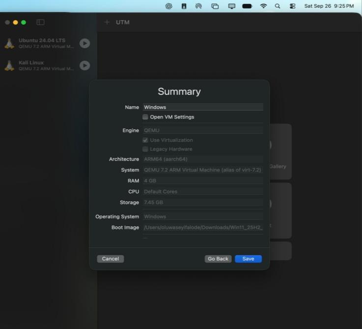

*Figure 1 — Original UTM configuration screen, PDF page 5. It shows ARM64 and 4 GB RAM; its displayed storage/default-core values differ from the guide's recommended final allocation.*

UTM Guest Tools improve display and input integration. Sysmon is then installed inside the Windows guest using the ARM64 executable. The source's installation command is:

```powershell
# Inside the isolated Windows VM, from the extracted Sysmon directory.
# -accepteula accepts the Sysinternals license when you run this command.
.\Sysmon64a.exe -accepteula -i
Get-Service Sysmon64a
Get-WinEvent -ListLog *Sysmon*
```

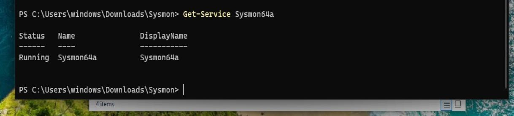

*Figure 2 — The original service query reports Sysmon64a Running. PDF page 8.*

Installation is the starting point. The next task is to establish which event categories are actually available and what the active configuration collects.

## Phase 2: Reconstruct Process Lineage

A process-create record answers more than “what executable ran?” It supplies command-line, user and parent context. The source exercise starts CMD from PowerShell and Notepad from CMD.

```text
powershell.exe
    └── cmd.exe
         └── notepad.exe
```

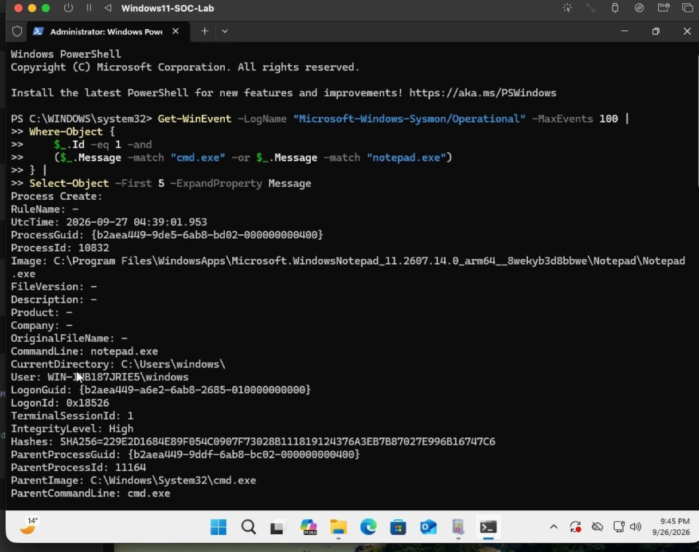

*Figure 3 — The visible event shows Notepad with cmd.exe as ParentImage. This proves that edge; the complete three-process chain requires the corresponding parent record. PDF page 11.*

| Field | Investigation use |
|---|---|
| Image / CommandLine | Identify what ran and how |
| User / IntegrityLevel | Understand execution context |
| ProcessGuid | Correlate one process instance across events |
| ParentProcessGuid | Find the corresponding parent process-create event |
| ProcessId / ParentProcessId | Useful local identifiers, with PID-reuse caveats |
| UtcTime / TimeCreated | Place events in a documented review interval |

The discovery exercise includes both `whoami` and `cmd.exe /c ipconfig`. This distinction matters later: the Sigma discovery rule checks the **immediate** parent, so CMD-parent ipconfig falls outside it. A direct PowerShell-to-ipconfig launch is a different positive case.

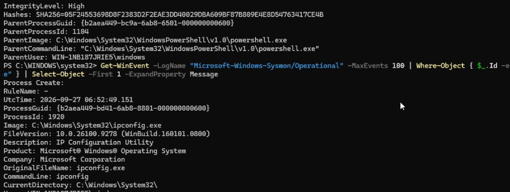

*Figure 4 — The crop shows ipconfig.exe execution, but its lower parent fields are not visible. The fields above the command belong to another record fragment; they must not be attributed to ipconfig. PDF page 13.*

## Phase 3: Find and Repair the Collection Gap

The source creates a harmless Temp text file, then searches for Event ID 11. The query returns no matching output. That is a retrieval result to investigate, not proof that the endpoint never generated a record.

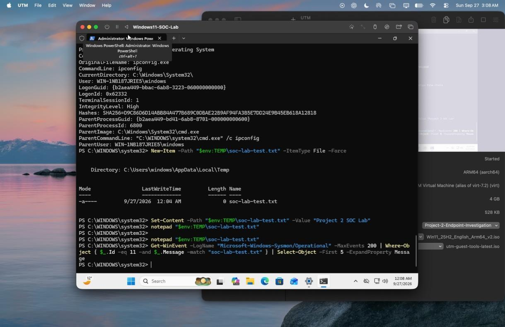

*Figure 5 — File creation and a query without matching output. The latest-200-event limit and collection configuration both matter. PDF page 14.*

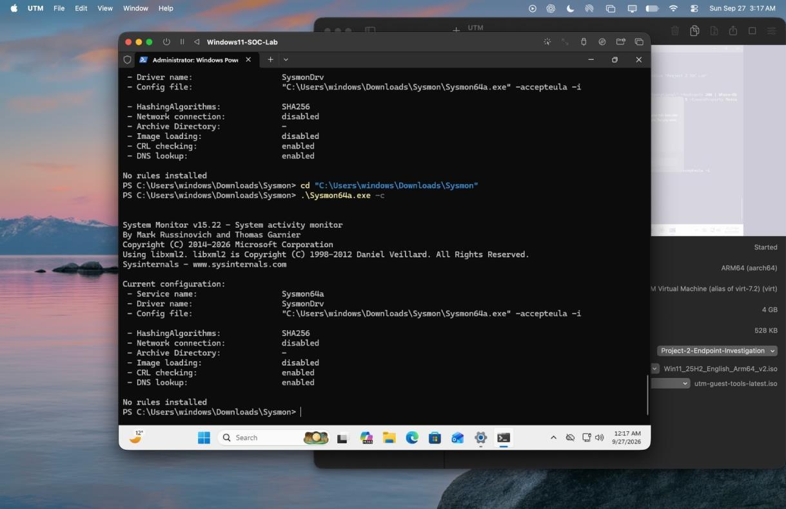

*Figure 6 — The active configuration reports network collection disabled and no rules installed. PDF page 15.*

The [published lab XML](config/sysmon-lab-config.xml) explicitly covers the four categories:

```xml
<Sysmon schemaversion="4.91">
  <HashAlgorithms>sha256</HashAlgorithms>
  <EventFiltering>
    <ProcessCreate onmatch="exclude"></ProcessCreate>
    <NetworkConnect onmatch="exclude"></NetworkConnect>
    <FileCreate onmatch="exclude"></FileCreate>
    <DnsQuery onmatch="exclude"></DnsQuery>
  </EventFiltering>
</Sysmon>
```

Empty exclusions intentionally provide broad collection for learning. This is a lab configuration, not a tuned enterprise baseline.

```powershell
.\Sysmon64a.exe -c .\sysmon-lab-config.xml
.\Sysmon64a.exe -c
```

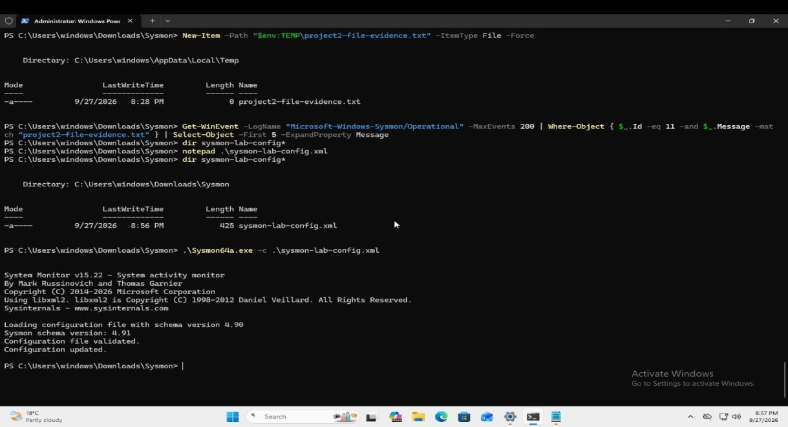

*Figure 7 — The original run accepted an input file using schema 4.90 while reporting binary schema 4.91. The PDF's published appendix and repository XML use 4.91. The image verifies the original update, not a new application of the repository file. PDF page 16.*

## Phase 4: Investigate Files, Network and DNS

### Event ID 11 — Process-to-file evidence

After configuration, the source creates `project2-file-evidence-2.txt` and retrieves a record naming PowerShell as the creator.

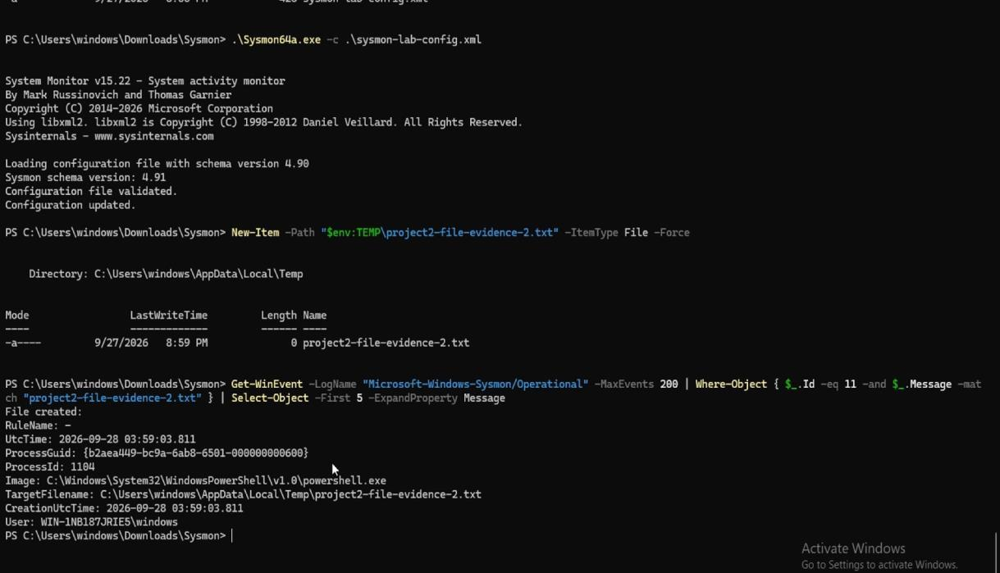

*Figure 8 — Event ID 11 includes PowerShell Image and the Temp TargetFilename. Its visible UtcTime is 2026-09-28 03:59:03.811. PDF page 17.*

This is strong evidence of file creation. It does not prove the file was executed. Its `.txt` extension also means it does not match the later script/executable rule.

### Event ID 3 — Process-to-network evidence

A useful network record includes Image, ProcessGuid, protocol, source, destination and Initiated. Retrieve it within a specific interval, then confirm the process identity.

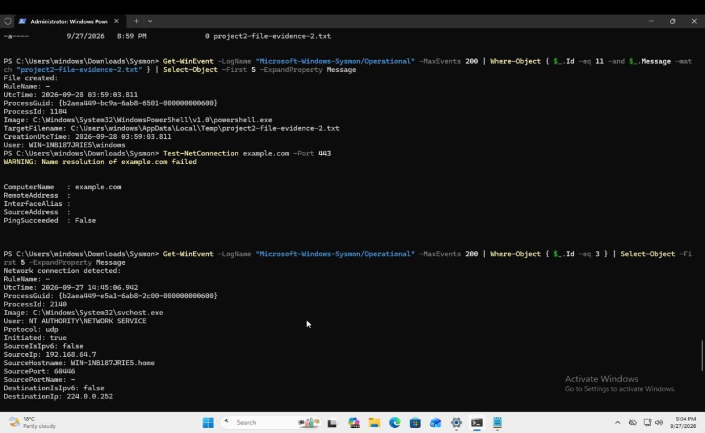

*Figure 9 — The screenshot includes a failed example.com name-resolution test and an older svchost.exe UDP event. The returned event is background network evidence, not proof that the failed test connected. PDF page 18.*

### Event ID 22 — DNS visibility

The guide uses `nslookup microsoft.com` as controlled activity. DNS answers and connection records address different questions and must be correlated explicitly.

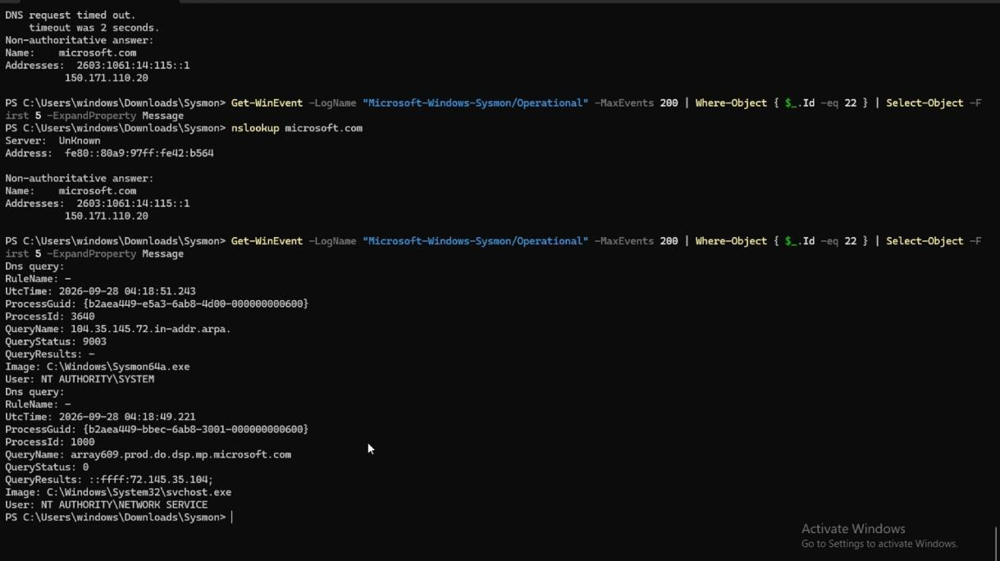

*Figure 10 — DNS event fields are visible, including queries from Sysmon64a.exe and svchost.exe. Those displayed records do not independently establish the exact nslookup-to-microsoft.com attribution. PDF page 19.*

The lesson is practical: “a DNS event appeared after my command” is weaker than “this event has the expected process, query name and timestamp.”

## Phase 5: Build a Scoped Timeline

The source combines discovery, Temp file creation and a DNS lookup:

```powershell
whoami
ipconfig
New-Item "$env:TEMP\incident-note.txt" -ItemType File -Force
nslookup microsoft.com
```

These are authorised lab actions. A separate network validation event should not be silently inserted into this exact command sequence.

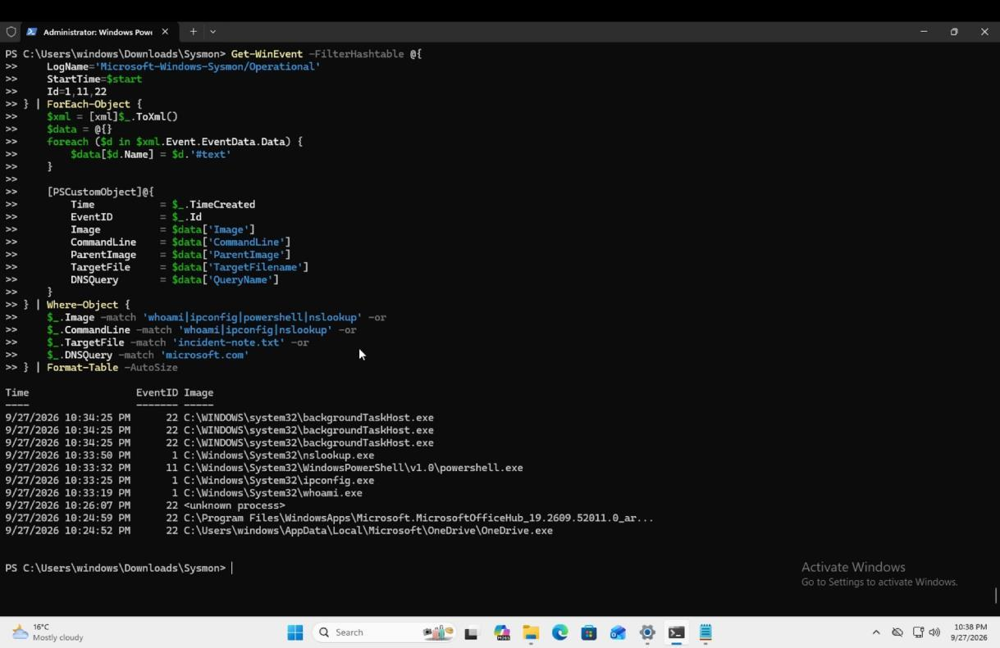

*Figure 11 — The source's filtered table includes process, file and DNS entries. It is displayed newest-first and its query omits Event ID 3. PDF page 21.*

The added [Get-SysmonTimeline.ps1](scripts/Get-SysmonTimeline.ps1) improves the reusable query by exposing named fields, including all four categories, retaining process identities, and sorting ascending. It is a **new companion script reviewed statically**, not a claimed new Windows execution.

```powershell
$events = .\scripts\Get-SysmonTimeline.ps1 `
    -StartTime '2026-09-28T03:00:00Z' `
    -EndTime '2026-09-28T07:00:00Z'

$events | Format-Table EventTimeUtc, EventId, Image, TargetFilename, QueryName
```

Use your actual review period. Preserve original event records when available; a formatted table can truncate columns and should not replace raw evidence. See [script usage](scripts/README.md) for CSV/JSON export and ProcessGuid filtering.

## Phase 6: Design Three Sigma Detections

Each rule remains `experimental`. Full YAML files are in [detections](detections); the [design notes](docs/detection-design.md) explain scope, benign matches and backend assumptions.

### Rule 1 — PowerShell launching discovery utilities

[Rule file](detections/powershell-discovery.yml) · `process_creation` · Sysmon Event ID 1

```yaml
selection_parent:
  ParentImage|endswith:
    - '\powershell.exe'
    - '\pwsh.exe'
selection_child:
  Image|endswith:
    - '\whoami.exe'
    - '\ipconfig.exe'
condition: selection_parent and selection_child
```

**Why it is useful:** it identifies direct PowerShell discovery-tool launches for review.

**Coverage limit:** `PowerShell -> CMD -> ipconfig` does not match. The rule performs no recursive ancestry traversal. Approved administration can satisfy the same conditions.

### Rule 2 — PowerShell creating a script/executable in Temp

[Rule file](detections/powershell-temp-file.yml) · `file_event` · Sysmon Event ID 11

| Condition | Required value |
|---|---|
| Creating process | powershell.exe or pwsh.exe |
| Target path | Contains `\Temp\` or `\AppData\Local\Temp\` |
| Target extension | .exe, .dll, .ps1, .bat or .vbs |

**Why it is useful:** it narrows file review to script/executable-like artifacts created by PowerShell.

**Coverage limit:** the original title says “User Temp”, but `\Temp\` also matches Windows Temp and other such path segments. The original rule is preserved; this broader scope is documented and tested. The earlier `.txt` file does not match. Creation does not prove execution.

### Rule 3 — PowerShell outbound network connection

[Rule file](detections/powershell-network.yml) · `network_connection` · Sysmon Event ID 3

```yaml
selection:
  Image|endswith:
    - '\powershell.exe'
    - '\pwsh.exe'
  Initiated: 'true'
condition: selection
```

**Why it is useful:** it identifies connections initiated by PowerShell for contextual review.

**Coverage limit:** the rule does not constrain destination, port or protocol. The guide's `1.1.1.1:443` test is not an IOC or a rule condition. Backend mapping for the Initiated field must be verified.

### ATT&CK context

| Technique | Relevant lab behaviour | Interpretation boundary |
|---|---|---|
| [T1033 — System Owner/User Discovery](https://attack.mitre.org/techniques/T1033/) | whoami | Describes user discovery; not a maliciousness verdict |
| [T1016 — System Network Configuration Discovery](https://attack.mitre.org/techniques/T1016/) | ipconfig | Describes network-configuration discovery |
| [T1059.001 — PowerShell](https://attack.mitre.org/techniques/T1059/001/) | Interpreter launches and actions | Does not establish C2, persistence or exfiltration |

## Phase 7: Validate Without Overstating the Result

Validation is separated into distinct layers:

| Layer | Result / evidence | What it does not establish |
|---|---|---|
| Original Windows activity | Supplied execution screenshots | A fresh endpoint run during publication |
| Manual positive-field checks | Reported in the PDF for all three rules | Every required field being visible in the embedded crops |
| YAML/core-field QA | Three files parsed; identifiers and required sections checked locally | Full Sigma semantic validation |
| XML QA | Published config parses and contains expected categories | Acceptance by a running Windows Sysmon instance |
| Synthetic selector fixtures | 24 local positive/negative/boundary cases pass | Backend execution, real alerts or production detection accuracy |
| SIEM deployment | Not performed | No deployment or alert claim |

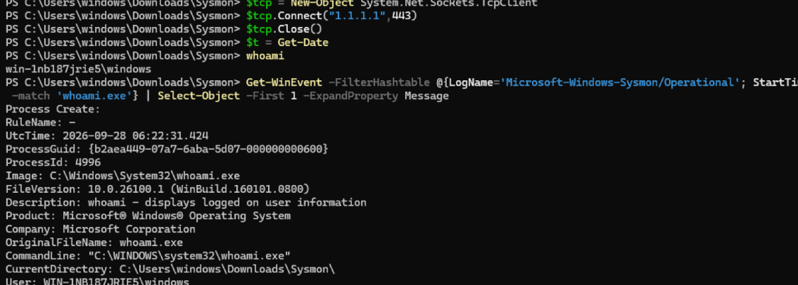

*Figure 12 — The whoami record is visible; ParentImage is below the crop. The source reports parent-field confirmation, but this image alone is incomplete. PDF page 26.*

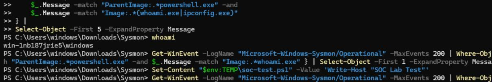

*Figure 13 — Commands create soc-test.ps1 and query events. The returned Event ID 11/TargetFilename is not visible in this crop. PDF page 26.*

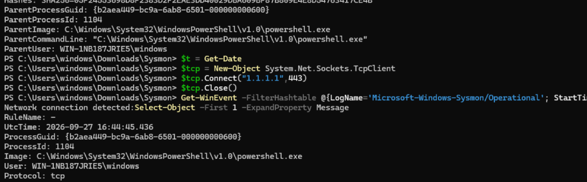

*Figure 14 — PowerShell Image, process identity and TCP are visible. Initiated/destination fields are below the crop, and the UtcTime is earlier than the later validation sequence. PDF page 27.*

### Added offline test coverage

| Rule | Synthetic cases | Examples |
|---|---:|---|
| Discovery | 8 | Direct whoami/ipconfig, pwsh, mixed case; reject CMD parent, Notepad, missing parent, wrong category |
| Temp artifact | 8 | User Temp, Windows Temp, executable; reject .txt, non-Temp, wrong creator, missing path, extra suffix |
| Network | 8 | PowerShell/pwsh, alternate destination; reject non-initiated, svchost, missing field, wrong category, unmapped boolean |

The harness reads the real YAML files and evaluates only their supported selector subset. Fixtures are **invented test inputs**, stored separately from screenshots. They are not exported Windows logs. See [validation scope](validation/README.md) and the [saved local report](evidence/local-validation.txt).

## Phase 8: Assess and Recommend Response

**Disposition: authorised simulation; no demonstrated compromise.** The project demonstrates investigation and detection design. Common tools, a Temp file or a connection on port 443 are insufficient to establish an attack.

For unexpected enterprise activity, the [response playbook](docs/response-playbook.md) recommends validating the user, parent process, command line and host context; preserving source records; scoping related activity; and taking proportionate action under the organisation's process when evidence warrants it.

No EDR isolation, malicious-file removal, enterprise recovery or production account change was performed here.

---

## How to Reproduce

### Option A — Review and validate on macOS, Linux or Windows

Python 3.9+ and the pinned PyYAML dependency are sufficient for the offline checks. These checks do not launch Windows processes or contact the lab's test destinations.

```bash
git clone https://github.com/seyifalode-cmd/soc-endpoint-investigation-lab.git
cd soc-endpoint-investigation-lab
python3 -m venv .venv
source .venv/bin/activate
python -m pip install -r requirements-validation.txt
python validation/check_project.py
```

On Windows, use your Python launcher and `.venv\Scripts\Activate.ps1` instead of the Unix activation command. Expected final result:

```text
PASS: 3 rule files; 1 XML config; 24 synthetic cases; source integrity; document links
Not performed: Windows execution, Sigma semantic/backend validation, SIEM alerts, production measurement.
```

### Option B — Rebuild the endpoint lab

Follow the [32-page build-along PDF](docs/Project-2-Endpoint-Investigation-Build-Along.pdf) in your isolated Windows VM:

1. Prepare Windows 11 ARM and Guest Tools in UTM.
2. Install the matching Sysmon architecture and verify its service/channel.
3. Inspect collection; apply and verify the [lab configuration](config/README.md).
4. Generate the controlled process, file, DNS and separate network exercises.
5. Capture full records with explicit time bounds, IDs and correlation fields.
6. Review the three rules and their positive/negative conditions.
7. Preserve results and document the authorised-simulation disposition.

Use the [evidence review](docs/evidence-review.md) alongside the PDF for screenshot qualifications and the [troubleshooting guide](docs/troubleshooting.md) for known issues. The supplied commands are reproduction material; publication did not execute them against a live VM.

### Before promoting any rule

Choose a Sigma backend and field pipeline, perform semantic/translation validation, replay complete positive and negative records, confirm actual alerts, baseline approved activity and measure volume. Retain results before changing the rule's experimental status.

## Repository Structure

```text
soc-endpoint-investigation-lab/
├── README.md
├── requirements-validation.txt
├── config/
│   ├── sysmon-lab-config.xml       # Published broad lab collection
│   └── README.md
├── detections/
│   ├── powershell-discovery.yml
│   ├── powershell-temp-file.yml
│   └── powershell-network.yml
├── scripts/
│   ├── Get-SysmonTimeline.ps1      # Added read-only query companion
│   └── README.md
├── validation/
│   ├── check_project.py           # Static QA and limited selector harness
│   ├── synthetic-cases.json       # 24 explicitly synthetic cases
│   └── README.md
├── screenshots/                   # 15 original embedded figures
│   └── README.md                  # Exact source-page register
├── evidence/
│   ├── source-manifest.json       # Original PDF and figure hashes
│   └── local-validation.txt
└── docs/
    ├── Project-2-Endpoint-Investigation-Build-Along.pdf
    ├── detection-design.md
    ├── evidence-review.md
    ├── response-playbook.md
    ├── troubleshooting.md
    └── references.md
```

## Lessons Learned

- **Installation and collection differ.** A healthy service still needs the intended configuration.
- **Immediate parent and ancestry differ.** Rule 1 has a deliberate CMD-mediated coverage gap.
- **An empty query has several explanations.** Consider time range, latest-N limits, event retention and collection before concluding nothing happened.
- **A screenshot needs field-level reading.** Captions, nearby commands and image order cannot replace event timestamps and process identity.
- **DNS is not a connection.** Correlate each source explicitly and preserve background events as background evidence.
- **Titles can be narrower than selectors.** Rule 2's path logic extends beyond per-user Temp.
- **Validation claims need a named layer.** Parsing, field review, synthetic logic checks, backend translation and live alerts are separate milestones.

## Skills Demonstrated

**Endpoint instrumentation:** Windows ARM lab preparation, Sysmon service verification, collection configuration and telemetry-gap investigation.

**SOC investigation:** process lineage, named-field extraction, time scoping, ProcessGuid correlation, and process/file/network/DNS interpretation.

**Detection engineering:** three Sigma patterns, positive/negative selection reasoning, false-positive considerations and experimental-rule boundaries.

**Incident communication:** supported ATT&CK mappings, proportionate response recommendations, source provenance, reproducible tests and explicit evidence limitations.

---

*Oluwaseyi Michael Falode · Cybersecurity & Cloud Security Engineer · Toronto, ON · September 2026*

[GitHub](https://github.com/seyifalode-cmd) · [LinkedIn](https://www.linkedin.com/in/oluwaseyi-falode-bb3b1651/) · [Related project: SOC Identity Investigation](https://github.com/seyifalode-cmd/soc-identity-investigation-lab)
